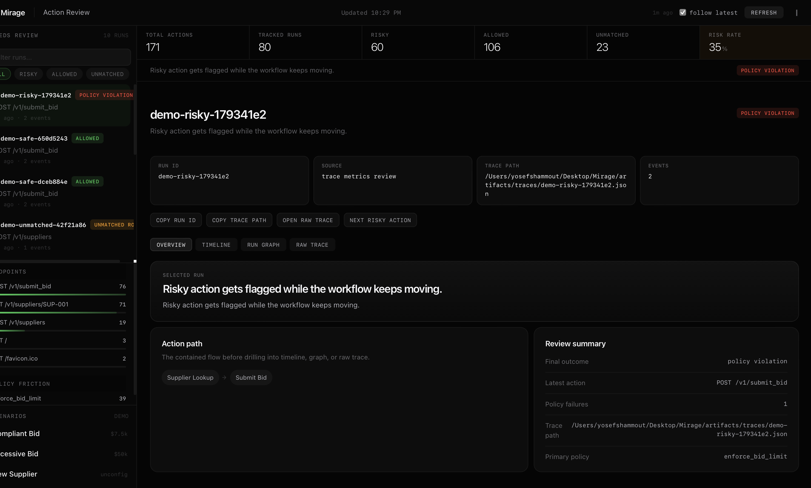
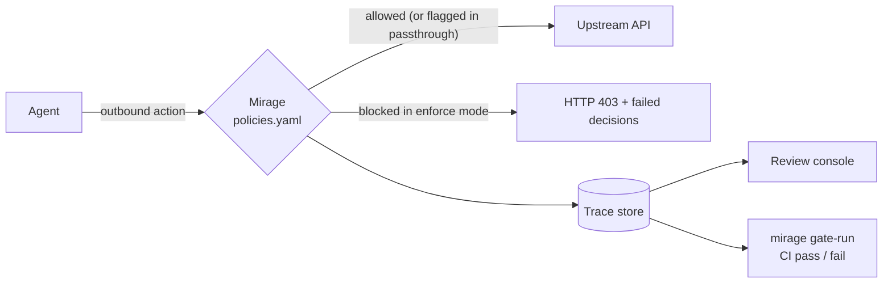

<div align="center">

# Mirage

**A deterministic policy gateway for AI agent actions.**<br>
One YAML policy file enforces at runtime and gates CI before merge. No model in the decision loop.

[](https://github.com/ysham123/Mirage/actions/workflows/ci.yml)
[](https://pypi.org/project/mirage-ci/)
[](https://pypi.org/project/mirage-ci/)
[](LICENSE)

[Quick start](#quick-start) · [Policies](#policies-you-can-express) · [Benchmarks](#benchmarks) · [Integrate](#integrate-your-own-agent) · [Console](#action-review-console) · [Docs](#documentation)

</div>

---

<p align="center">
  
  <br><sub>The review console over a risky procurement run.</sub>
</p>

## Why Mirage

Agents don't just generate text. They submit bids, change billing records, file tickets, and call APIs that move money. A bad retry, a hallucinated route, or an out-of-policy payload can charge a customer twice or leak data, and it often only shows up after deploy.

Mirage sits between an agent and the systems it acts on. Every outbound action is checked against a declarative policy and decided by rules, not by a model: **allowed**, **flagged**, or **blocked**. Because the decision is deterministic, the same policy file can fail a CI build before merge and enforce the same rules at runtime.



## One policy file, two modes

| | **Gateway mode** | **CI mode** |
| --- | --- | --- |
| Runs against | Real upstream traffic | Mocked responses (`mocks.yaml`) |
| Entry point | `mirage gateway` | `mirage.proxy`, `MirageSession`, `mirage gate-run` |
| Outcomes | `allowed`, `flagged`, `blocked`, `error` | `allowed`, `policy_violation`, `unmatched_route`, `config_error` |
| Use it to | Log decisions in `passthrough`, then block in `enforce` | Fail the build when a run breaks policy |

Both modes share one `PolicyEvaluator`: pure, deterministic, and identical in production and CI.

## Quick start

```bash
pip install mirage-ci        # Python 3.11+, imports as `mirage`
```

<table>
<tr>
<td width="50%" valign="top">

**Runtime gateway in 60 seconds**

Start the gateway in front of an upstream with the bundled PII policy:

```bash
mirage gateway \
  --upstream https://your-api.example.com \
  --mode passthrough \
  --policies-path examples/policies/pii_redaction.yaml
```

Send a request with an SSN-shaped string:

```bash
curl -X POST http://127.0.0.1:8001/v1/customer/profile \
  -H "Content-Type: application/json" \
  -d '{"name": "Alice", "ssn": "123-45-6789"}'
```

Mirage logs a `flagged` decision and forwards the request. With `--mode enforce`, the same request returns HTTP 403 with the failed decisions in the body.

</td>
<td width="50%" valign="top">

**CI gate in 60 seconds**

Start the proxy with the bundled mocks and policies:

```bash
python -m uvicorn mirage.proxy:app --host 127.0.0.1 --port 8000
```

Submit a bid above the policy limit, then gate the run:

```bash
python <<'PY'
from mirage import MirageSession

with MirageSession(run_id="sixty-second-demo") as mirage:
    mirage.post("/v1/submit_bid", json={"bid_amount": 99999})
PY

mirage gate-run --run-id sixty-second-demo
```

`gate-run` exits non-zero, which is the same signal that fails a CI build.

</td>
</tr>
</table>

```text
Mirage run: sixty-second-demo
Summary: 1 action(s), 0 safe, 1 risky
Risky actions:
- [policy_violation] POST /v1/submit_bid (event 1, mock=submit_bid):
  enforce_bid_limit: Agents cannot submit bids above the approved threshold.
  (bid_amount lte 10000, got 99999)
```

If the `mirage` script is not on your `PATH`, use `python -m mirage.cli ...`. For a multi-step example, see the [procurement harness](examples/procurement_harness/README.md).

## Policies you can express

A policy names an endpoint, a field, an operator, and a message:

```yaml
policies:
  - name: enforce_bid_limit
    method: POST
    path: /v1/submit_bid
    field: bid_amount
    operator: lte
    value: 10000
    message: Agents cannot submit bids above the approved threshold.
```

Five starting policies ship in [`examples/policies/`](examples/policies):

| File | What it prevents |
| --- | --- |
| `pii_redaction.yaml` | SSNs, payment-card numbers, and email addresses in outbound payloads |
| `prompt_injection.yaml` | Common prompt-injection markers in outbound payload text |
| `outbound_allowlist.yaml` | Outbound traffic to hosts that are not on an allowlist |
| `cost_guard.yaml` | Spending above approved per-call thresholds (bids, refunds, transfers) |
| `output_length_cap.yaml` | Runaway text generation flooding downstream systems |

**Operators:** `exists`, `eq`, `neq`, `lt`, `lte`, `gt`, `gte`, `in`, `not_in`, `regex_match`, `not_regex_match`, `contains`, `not_contains`, `starts_with`, `not_starts_with`, `ends_with`, `length_lte`, `length_gte`, `host_in`, `host_not_in`.

## Benchmarks

`make bench` replays 100 labelled synthetic actions per scenario through the gateway in `enforce` mode against an in-process stub upstream.

| Scenario | Containment | False-positive rate | Precision | Per-policy decision latency p50 / p95 / p99 |
| --- | ---: | ---: | ---: | ---: |
| `pii_leak` | 1.000 | 0.000 | 1.000 | 2 / 4 / 6 µs |
| `prompt_injection` | 1.000 | 0.000 | 1.000 | 4 / 7 / 7 µs |
| `cost_runaway` | 1.000 | 0.000 | 1.000 | 1 / 2 / 4 µs |

> [!IMPORTANT]
> These scenarios are synthetic, and the bad actions are built to match the policies. They establish a reproducible methodology and a latency floor. They say nothing yet about adversarial inputs that evade the patterns, or benign inputs that trip them. Adversarial scenarios are the next benchmark milestone. Full methodology and limits are in [`BENCHMARKS.md`](BENCHMARKS.md).

## How Mirage compares

| Category | What it does | Where Mirage differs |
| --- | --- | --- |
| LLM-judge evaluation | A model scores whether an *output* was good | Mirage checks *actions* with rules, so a CI build can fail deterministically |
| Observability | Records what happened | Mirage decides before the action reaches the upstream |
| Framework-bundled guardrails | Hooks inside one agent framework | The same `policies.yaml` covers any agent that crosses an HTTP boundary you control |
| HTTP mocking and replay (`pytest-httpx`, `respx`, VCR.py) | Per-test stubs or recorded cassettes | Run-scoped policy and trace, so a new risky action is caught the first time it appears |

**When not to use Mirage today**

- Your agent's side effects don't cross an HTTP boundary you control (direct DB writes, filesystem changes, subprocess calls).
- Your criteria are subjective ("did the answer sound right?"). That is an evaluation problem, not a policy rule.
- You have neither a CI step that can run the agent nor a staging path that can route through a gateway.

## Integrate your own agent

`MirageSession` gives the agent an `httpx` client, one run ID, and one assertion point for CI:

```python
from mirage import MirageSession

with MirageSession(run_id="demo-run") as mirage:
    response = mirage.post(
        "/v1/submit_bid",
        json={"contract_id": "STANDARD-7", "bid_amount": 7500},
    )
    summary = mirage.assert_clean()
    print(summary.trace_path)
```

**Framework adapters** route framework-native tool calls through Mirage with no change to the policy decisions:

| Framework | Adapter | Install |
| --- | --- | --- |
| OpenAI Agents SDK | `mirage.integrations.openai_agents.wrap_with_mirage` | `pip install mirage-ci[openai-agents]` ([guide](docs/INTEGRATIONS_OPENAI_AGENTS_SDK.md)) |
| LangChain | `mirage.integrations.langchain.wrap_with_mirage` | `pip install mirage-ci[langchain]` ([guide](docs/INTEGRATIONS_LANGCHAIN.md)) |

**CI gating:**

```bash
python -m mirage.cli summarize-run --run-id procurement-risky-demo
python -m mirage.cli gate-run --run-id procurement-risky-demo     # non-zero on risky or missing runs
python -m mirage.cli validate-config                               # non-zero on missing or malformed config
```

<details>
<summary><strong>Per-response primitives and response headers</strong></summary>

If you want per-response access instead of a run-level session:

```python
from mirage.httpx_client import (
    assert_mirage_response_safe,
    create_mirage_client,
    mirage_response_report,
)

with create_mirage_client(run_id="demo-run") as client:
    response = client.post(
        "/v1/submit_bid",
        json={"contract_id": "STANDARD-7", "bid_amount": 7500},
    )
    report = mirage_response_report(response)
    assert_mirage_response_safe(response)
    print(report.trace_path)
```

Mirage adds metadata headers so tests and agents can inspect a decision without changing the mocked body: `X-Mirage-Run-Id`, `X-Mirage-Outcome`, `X-Mirage-Policy-Passed`, `X-Mirage-Trace-Path`, `X-Mirage-Matched-Mock`, `X-Mirage-Message`, `X-Mirage-Decision-Summary`.

For agent code that already expects a client-like object:

```python
from examples.procurement_harness.agent import ProcurementAgent
from mirage import MirageSession

with MirageSession(run_id="procurement-safe") as mirage:
    agent = ProcurementAgent(mirage)
    result = agent.run_compliant_bid_workflow()
    summary = mirage.assert_clean()
    print(result.action.mirage.outcome)
    print(summary.to_text())
```

</details>

<details>
<summary><strong>If your agent doesn't use <code>httpx</code></strong></summary>

Mirage only needs the outbound action path to cross a client boundary you control.

- If your SDK or framework lets you inject a base URL, transport, or HTTP client, point it at Mirage.
- If your orchestration layer hides HTTP entirely, wrap the side-effecting calls in your own gateway and test that gateway with Mirage.
- Start with writes: bids, orders, ticket creation, CRM updates, or billing actions.

See [`docs/INTEGRATION_PATTERNS.md`](docs/INTEGRATION_PATTERNS.md) for concrete patterns, and [`docs/INTEGRATIONS_DATABASE.md`](docs/INTEGRATIONS_DATABASE.md) for a SQLAlchemy event-hook pattern for database writes.

</details>

<details>
<summary><strong>Config and environment variables</strong></summary>

The onboarding config lives in [`examples/procurement_harness/mocks.yaml`](examples/procurement_harness/mocks.yaml) and [`examples/procurement_harness/policies.yaml`](examples/procurement_harness/policies.yaml). From a repo checkout, the root [`mocks.yaml`](mocks.yaml) and [`policies.yaml`](policies.yaml) are the default fallback, and the installed package ships bundled defaults so the CLI and proxy boot outside the source tree.

Optional environment variables: `MIRAGE_PROXY_URL`, `MIRAGE_RUN_ID`, `MIRAGE_MOCKS_PATH`, `MIRAGE_POLICIES_PATH`, `MIRAGE_ARTIFACT_ROOT`.

Validate config before a local run or CI job with `make mirage-validate-config`.

</details>

## Gateway forwarding behavior

The gateway is an in-line proxy: every request the agent makes flows through it to the configured upstream.

- **Application headers are forwarded unchanged**, including `Authorization` and `Cookie`, so upstream auth keeps working. Pointing `--upstream` at an unintended host would forward those credentials there.
- **`X-Mirage-*` and hop-by-hop headers are stripped** before forwarding (`Connection`, `Transfer-Encoding`, `Upgrade`, `Host`, `Content-Length`, and similar).
- **Bodies are stored verbatim in the trace.** If a payload contains secrets, redact them in policy or keep them out of the body.
- **Recommended posture:** bind the gateway to a private network, scope `--upstream` to a single host you own, and start in `passthrough`. Tune policies against real traffic, then switch to `enforce`.

## Action review console

Two console surfaces read the same trace store:

- [`demo_ui/`](demo_ui): the FastAPI console API plus a zero-dependency HTML shell (`make demo-ui`, then open `http://127.0.0.1:5100`)
- [`ui/`](ui): a Next.js operator client over that API (`make ui-install && make ui-dev-local`, then open `http://127.0.0.1:3000`)

Both show aggregate action counts, a review queue of risky runs, top endpoints and policy failures, containment rate (fleet-wide and per run), and a per-run view of request, outcome, policy reasoning, and decision graph.

## Examples

| Example | What it shows |
| --- | --- |
| [`examples/procurement_harness/`](examples/procurement_harness) | A full workflow: look up a supplier, submit a compliant or risky bid, inspect outcomes and traces (`make proxy-procurement`, then `make procurement-demo-safe`, `make procurement-demo-risky`, `make test-procurement`) |
| [`examples/policies/`](examples/policies) | The five starting policies above |
| [`examples/safe_agent.py`](examples/safe_agent.py) | A safe request that passes policy checks |
| [`examples/rogue_agent.py`](examples/rogue_agent.py) | An unsafe request that is flagged while control flow continues |
| [`examples/unmatched_route.py`](examples/unmatched_route.py) | An unmatched route that fails clearly |

Run everything in Docker with `docker compose up --build` (proxy with the procurement config on `http://localhost:8000`).

## Roadmap

- Adversarial benchmark scenarios with realistic false-positive surfaces
- A chaos-testing harness to check that policies hold in hostile environments
- Async-native gating in the LangChain adapter
- Policy-file caching with an mtime check, and CI thresholds on benchmark results

## Documentation

| Doc | Contents |
| --- | --- |
| [`docs/README.md`](docs/README.md) | Docs hub |
| [`docs/FIRST_INTEGRATION.md`](docs/FIRST_INTEGRATION.md) | 30-minute walkthrough for your own `httpx` agent |
| [`docs/CI_INTEGRATION.md`](docs/CI_INTEGRATION.md) | pytest and GitHub Actions gating recipes |
| [`docs/INTEGRATION_PATTERNS.md`](docs/INTEGRATION_PATTERNS.md) | Framework-agnostic integration paths |
| [`BENCHMARKS.md`](BENCHMARKS.md) | Benchmark methodology, numbers, and limits |
| [`docs/OPEN_SOURCE_FAQ.md`](docs/OPEN_SOURCE_FAQ.md) | MIT licensing and commercial use |

<details>
<summary><strong>Repository layout</strong></summary>

| Path | Contents |
| --- | --- |
| [`mirage/engine.py`](mirage/engine.py) | Policy evaluation, outcomes, and trace writes |
| [`mirage/gateway.py`](mirage/gateway.py) | Runtime gateway against real upstreams |
| [`mirage/proxy.py`](mirage/proxy.py) | FastAPI CI-mode boundary and response headers |
| [`mirage/httpx_client.py`](mirage/httpx_client.py) | `httpx` helper and response assertions |
| [`mirage/integrations/`](mirage/integrations) | Framework adapters |
| [`benchmarks/`](benchmarks) | Reproducible benchmark harness |
| [`demo_ui/`](demo_ui), [`ui/`](ui) | Console API and clients |
| [`tests/`](tests) | Engine, proxy, gateway, integration, and helper tests |
| [`docs/worklog/`](docs/worklog) | Per-task review log (`make worklog TITLE="..."`) |

</details>

## Contributing

Bug reports and pull requests are welcome. See [`CONTRIBUTING.md`](CONTRIBUTING.md), [`CODE_OF_CONDUCT.md`](CODE_OF_CONDUCT.md), and [`SECURITY.md`](SECURITY.md) for private vulnerability reporting.

```bash
git clone https://github.com/ysham123/Mirage
cd Mirage
pip install setuptools wheel
pip install -e '.[dev]'      # or: make install
```

## License

[MIT](LICENSE)
